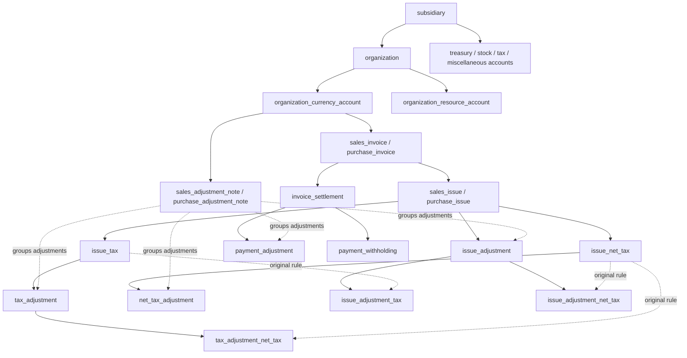

# Developing with sparse accounts and temporal calculations

This is the October 13 accounting contract. Start with the runnable
[17-record example](../../dev-tools/accounting/fixture-example.js), then use the
[public create schemas](schemas/). The accounting profile has 48 public tables.
It uses ordinary SurrealQL functions, typed references and the shared ordered-tree
compiler. No document generator or accounting workflow is required.

## The primitives

A record supplies identity and facts. A reference supplies a typed relationship.
A declared membership contributes a vector to a particular ordered root. These
roles are independent: references do not automatically create postings.

A root can collect information, enforce a constraint, publish a result, and
participate in another root. Choose each role explicitly. An invoice collects
its issue, tax and settlement contributions to validate capacity. Those sources
already contribute to accounts, organizations and subsidiaries, so the invoice
does not repeat their postings. The same principle applies to adjustment notes.

The useful standard for a new CRM, HRM or inventory feature is:

1. Name each input, unit, owner, effective position and typed relationship.
2. Define the contribution vector for each selected root and its perspective.
3. Express each linear constraint as a measure on each contribution.
4. State whether a calculation reads a direct field, a prefix, a predecessor,
   a bounded interval, or an entire aggregate.
5. Declare the corresponding dependencies, memberships and impact ranges.
6. Prove arithmetic, insert/edit/delete behavior, date/reference moves and
   rejected-write rollback with a source replay that does not call the formula.

For a constraint `aX(t) + bY(t) + cZ(t) >= L`, each source contributes
`a*delta_X + b*delta_Y + c*delta_Z` to one named measure. Its `instant_min`
validates every complete timestamp. Subtracting independent minima of X and Y
does not validate their difference. A bound on the final sum alone does not
protect earlier times.

## Dimensions, identity and units

`rebase_tenant` remains the authorization boundary. A `subsidiary` is a business
division within that tenant, with a reporting currency. An `organization` is a
counterparty within a subsidiary, also with a reporting currency.

| Record | Native identity/dimension | Main roots |
| --- | --- | --- |
| `currency`, `item`, `service`, `measure_unit` | Independent descriptors; currency precision and resource unit | No automatic financial aggregation |
| `subsidiary` | One reporting currency | `z_history`, `z_accounts`, `z_organizations` |
| `organization` | One subsidiary and reporting currency | `z_history`, unique `z_accounts` by native resource |
| `organization_currency_account` | Organization + currency | Native `z_history` |
| `organization_resource_account` | Organization + item/service | Native `z_history` |
| `treasury` | Subsidiary + currency + distinct record identity | Native `z_history` |
| `stock_account` | Subsidiary + operating unit + item/service | Native `z_history`, `z_gross` |
| `misc_currency_account`, `misc_stock_account` | Explicit miscellaneous positions | Native `z_history`; stock also has `z_gross` |
| `direct_tax_account`, `indirect_tax_account` | Subsidiary + currency + distinct record identity | Native `z_history` |
| `operating_unit` | One subsidiary, optional capacity | `z_capacity`, unique owned `z_stock_keys` |
| `exchange_pair` | Directed given resource → received resource, unique within tenant | `z_rates`, `z_readers`, `z_observations` |

Create only the native positions used by the application. An organization can
have INR, USD and a particular item without creating every possible combination
of descriptors. Several treasuries can hold INR. Owned physical stock does not
acquire another identity when a sale uses USD. A miscellaneous damage account
can coexist with owned stock for the same resource and operating unit.

Native currency histories contain that currency. Native resource histories
contain quantities of that item/service. `valuation_pair` converts a native
account's resource into its subsidiary's reporting currency. An organization
account additionally supplies `organization_pair` for its organization's currency.
Same-resource conversion requires no pair and uses one. Account dimensions,
reporting currencies and pair selections are immutable; create another position
for a different identity. Dates, constraints and transaction references remain
editable where the public schema exposes them.

## Perspectives and directional contributions

Each native financial contribution has `real`, `receivable`, `payable` and
`net = receivable - payable`. R/P contributions are nonnegative. Reducing a
receivable adds payable; reducing a payable adds receivable. Their totals are
directional accumulators, while their difference is the outstanding position.
Signed real movements and signed capacity measures remain ordinary algebra.

Owned treasury, stock and miscellaneous positions accept real movements only;
their R/P components stay zero. Reservations use separately named measures.
Counterparty accounts use the counterparty's perspective. Invoice claims use
the subsidiary's commercial perspective. A sale therefore adds payable at the
counterparty currency account and receivable at the invoice/subsidiary.

| Example | Owned native effect | Counterparty native effect | Invoice effect |
| --- | --- | --- | --- |
| Sale of quantity q for A | Stock real −q | Goods real +q; currency payable +A | Receivable +A; amount +A |
| Purchase of q for A | Stock real +q | Goods real −q; currency receivable +A | Payable +A; amount +A |
| Customer payment P | Treasury real +cash | Currency real −P; receivable +P | Payable +P; paid +P |
| Supplier payment P | Treasury real −cash | Currency real +P; payable +P | Receivable +P; paid +P |

All values in a row are expressed in their own root's unit; P is the converted
invoice-currency payment. Tax and correction rows follow the same directional
mapping. Separate resource and currency legs are intentional.

Organization histories convert and combine their native positions in the
organization's currency. Subsidiary histories expose these components:

| Component | Meaning in subsidiary currency |
| --- | --- |
| `real`, `owned_real` | Owned treasury and stock movements |
| `counterparty_real` | Mirrored counterparty real movement |
| `counterparty_receivable`, `counterparty_payable` | Mirrored counterparty claims |
| `tax_real`, `tax_receivable`, `tax_payable` | Tax position movements |
| `misc_real` | Miscellaneous expense/resource movements |
| `receivable`, `payable`, `net` | Counterparty and tax claims combined |

Do not add every real component and call it owned assets: the components
describe different perspectives. This profile defines calculation quantities;
it does not infer a statutory balance sheet or inventory cost method.

## Event-time valuation and function reactivity

`exchange_pair(given_resource, received_resource, initial_rate, effective_at)`
defines the fallback rate. Its `exchange_rate(pair, effective_at, rate)` records
define later unique dated rates. A rate is received units per given unit. Pairs
are shared across subsidiaries within a tenant; inverse pairs are independent.

`fn::accounting::rate_at(pair, from, to, at)` selects the last rate at or before
`at`. Before the first rate it uses the initial value, but it rejects dates before
the pair is effective. Currency outputs use native decimal ties-to-even rounding.
Each leg is rounded in its destination currency before coincident contributions
combine. Resource quantities preserve their native decimal quantity.

Every selected calculation date has a normal node in the pair's `z_readers`.
An authored `@rebase-impact` function returns `[changed_date, next_rate_date)`.
The coordinator refreshes those candidates, compares results and repairs changed
contributions. Moving or reparenting a rate selects the union of old and new
ranges. Deletion refreshes the gap left behind. An initial-rate edit stops at the
first dated rate. A reader's date/reference edit repairs its registration too.

This is event-time valuation. For example, opening stock of 200 at 10 contributes
2,000. A later sale of 10 while the valuation rate is 12 contributes −120, leaving
1,880 in that reporting history and 190 in the native quantity history. It does
not automatically mark those 190 remaining units to 12. A later quote affects
events whose calculation dates select it; it does not revalue all older events
merely because wall-clock time advances.

Trade observations are separate from authoritative rates. `resource_exchange`
contributes its given/received amounts to `z_observations`; those observations
never feed `rate_at`. Issue prices are explicit invoice-currency amounts per
resource unit, separate from the resource's reporting valuation.

For cumulative prefixes the safe dependency is an affected suffix. A later
contribution does not cancel an earlier one. Use the existing dependent prefix
membership protocol for that case. See the shared
[function-reactivity contract](../rebase-system/function-reactivity.md) for impact
function signatures, typed bounds, ordering, cycles and measured candidate work.

## Commercial graph and constraints



These arrows explain typed ancestry, not automatic tree enrollment. Issue
adjustment tax children inherit their adjustment's note. Tax recalculation
children also reference the particular original rule they apply.

An invoice has `amount` (issues, taxes and their signed corrections) and `paid`
(converted payments, withholding and signed payment corrections). It maintains
`balance = amount - paid` as one linear measure. Amount and paid must never be
negative. The cumulative balance at `invoice_date` and at every later complete
timestamp must be nonnegative. Covered advances can precede issues: create the covering
issue first, then enter the payment with its real earlier date. Original issues
and taxes cannot follow the invoice date. Empty invoices and notes are valid.

An issue starts at quantity Q and unit price P. An adjustment at t reads the
strictly earlier quantity and price, then contributes:

```text
Q_before = original quantity + earlier quantity deltas
P_before = original price + earlier price deltas
amount_delta = round((Q_before + delta_q) * (P_before + delta_p))
             - round(Q_before * P_before)
```

This includes the `delta_q * delta_p` interaction. A quantity change also moves
native stock; a pure price change does not. Adjustments must follow their source,
have at least one changed input, respect the original per-change magnitudes,
and leave chronological quantity, price and value nonnegative. One issue permits
one adjustment at a timestamp so its product state has a definite order.
Adjustments can occur before or after the invoice date; no separate return table
or date-dependent adjustment workflow is needed.

Payment adjustments use a signed treasury `amount_delta` and an optional explicit
`entered_invoice_delta`. Otherwise their invoice delta uses their own dated rate.
Both currencies have original per-change magnitude limits and cumulative reversal
capacity. Their directions must agree. Explicit converted deltas allow an
allocated original-currency reversal when the later exchange rate differs.

Issue, payment and manual tax adjustments require a sales/purchase note;
rule-linked tax children inherit it. An adjustment note selects one native
organization currency account and one commercial side. Its nonzero `amount - paid`
contributions must all have the same
sign. It can span invoices of that account. Zero rule differences are neutral.
It has no draft/finalization state. Use separate notes for opposing directions.

## Taxes and strict adjustment tables

For an original tax with rule f:

```text
f(B) = round(max(lower, min(B * rate / 100, upper)))
```

Absent upper means unbounded. `issue_tax` reads issue value through its timestamp.
`issue_net_tax` reads strictly earlier issue value, taxes and corrections. Net
taxes at the same timestamp therefore do not tax each other. A later net tax
can include them. Base-tax reader registration uses t + 1ns to express inclusive
base time while retaining the shared strict-prefix protocol.

| Table | Parent change | Original rule/source |
| --- | --- | --- |
| `tax_adjustment` | Explicit signed tax change; own note | `issue_tax` |
| `net_tax_adjustment` | Explicit signed net-tax change; own note | `issue_net_tax` |
| `issue_adjustment_tax` | `issue_adjustment` | `issue_tax` |
| `issue_adjustment_net_tax` | `issue_adjustment` | `issue_net_tax` |
| `tax_adjustment_net_tax` | `tax_adjustment` | `issue_net_tax` |

Rule-linked children inherit the original rule directly. Their dated prior basis
comes from the original basis plus earlier linked basis changes. The result is
`f(B_before + delta_B) - f(B_before)`. Applying f to a negative delta is incorrect
for capped or lower-bounded rules. For net-tax children, delta_B also includes
strictly earlier tax changes under the selected parent adjustment.

A linked adjustment must concern the same issue, follow the original tax's date,
and occur no earlier than its parent change. A change already included in the
original dated basis cannot have an additional linked child duplicating it.
The original tax's amount and converted account amount must retain nonnegative
cumulative reversal capacity. Each original/parent pair is unique. Distinct
linked changes on the same original tax need distinct timestamps; use a deliberate
small offset when their calculations depend on each other.

The application authors this graph. It decides which original rules need
recalculation and creates those children explicitly; the framework does not
invent missing tax children or make a tax-compliance decision.

## Other financial and production facts

`account_entry` and `stock_entry` are explicit native opening/manual effects.
`account_claim` creates a non-invoice directional claim at an organization or tax
account; `claim_settlement` consumes that particular source's capacity and moves
a selected native currency/resource account. Counterparty perspective determines
the actual incoming/outgoing leg. Tax-pool operations do not silently allocate
themselves to these source-specific claim roots.

Tax accounts keep signed auxiliary `credit_available` and `liability_available`
with nonnegative complete-time minima. Directional R/P alone cannot express
separate gross credit and liability capacities:

| Fact | Tax directional contribution | Capacity change | Real movement |
| --- | --- | --- | --- |
| `tax_settlement` | Receivable +converted | Liability −converted | Cash out, tax real in |
| `tax_deposit` | Receivable +converted | Credit +converted | Cash out, tax real in |
| `tax_refund` | Payable +converted | Credit −converted | Cash in, tax real out |
| `tax_offset` | Payable at credit account; receivable at liability account | Consume both | None |
| Sale/purchase `payment_withholding` | Tax receivable/payable respectively | Credit/liability added | None |

Eight cash tables support one inline bounded fee and fee-tax rule:
`invoice_settlement`, `payment_adjustment`, `claim_settlement`, `tax_settlement`,
`tax_deposit`, `tax_refund`, `resource_exchange`, `production_cost`. Fees leave
the gross invoice/claim settlement unchanged. The selected miscellaneous account
receives fee plus noncreditable tax; creditable fee tax adds tax credit. Fee
conversion uses `fee_exchange_pair` and `fee_tax_exchange_pair` at payment time.
Refunds can have their own fees. A resource exchange uses its outgoing currency
leg when present, otherwise its incoming currency leg; barter has no inline fee.

`resource_exchange` makes explicit paired real movements. It covers transfers,
damage movements, currency exchange and cross-subsidiary movements within one
tenant. Cross-subsidiary issues/settlements are rejected; use explicit paired
transfer legs when both business divisions participate.

`production` has starts/ends and subsidiary; its four child tables are
`production_input`, `production_output`, `production_cost`, `production_capacity`.
Inputs/costs reserve native quantity/cash at the start, consume it and release
the reservation at the end. Outputs record `expected` then actual quantity.
`available = real - reserved`; owned R/P stay zero. Production cost reserves fees
too. Reporting roots do not sum differently dated reservation conversions.

Gross inputs at one start must fit the availability strictly before that start;
same-time or future receipts cannot fund them. Operating capacity uses +used at
start and −used at end, allowing adjacent intervals. Resource availability and
duration restrictions propagate to input and capacity lines. Output-linked
exchanges cannot precede completion or consume more than that output's quantity.

## Query the graph and the selected trees

The following examples use the published `demo_*` fixture. Bind external values
as native `RecordId`, `Decimal` and `Date`; do not build SQL with user text.

```surql
-- Forward typed references.
RETURN sales_issue:demo_issue.invoice.account.organization.name;

-- Inverse REFERENCE traversal, not a relation-table arrow.
LET $issues = sales_invoice:demo_sale<~(sales_issue FIELD invoice);
SELECT id, quantity, price, amount FROM $issues;

-- One exact native position from the organization's unique resource index.
LET $position = fn::tree::read(organization:demo_customer, 'z_accounts',
    'find', [currency:demo_usd]);
RETURN SELECT * FROM ONLY $position.rid;

-- Aggregate all participants, or the half-open interval [start, end).
RETURN fn::tree::read(sales_invoice:demo_sale, 'z_history', 'summary', []);
RETURN fn::tree::read(sales_invoice:demo_sale, 'z_history', 'range',
    [[d'2027-01-01'], [d'2027-01-11']]);

-- Page the intrusive memberships, then project their source records.
LET $page = fn::tree::read(sales_invoice:demo_sale, 'z_history', 'page',
    [20, NONE, false]);
RETURN $page.items.map(|$entry| {
    member: $entry.link, key: $entry.key,
    source: (SELECT * FROM ONLY $entry.link.rid)
});

-- Corrected average sales price in this stock account's subsidiary currency.
LET $s = fn::tree::read(stock_account:demo_stock, 'z_history', 'summary', []);
RETURN IF ($s.measures.sales_quantity.sum ?? 0dec) > 0dec
    THEN $s.measures.sales_reporting_value.sum / $s.measures.sales_quantity.sum
    ELSE NONE END;
```

Pass the full returned `page.next` key as the next call's cursor; do not strip
its record/slot tie breakers. The revision detects a changed tree between calls,
but several pages do not form an automatic snapshot. Summary counts count
memberships, not necessarily source records. Coincident legs of one source into
one root/time combine into one maintained slot; a production record can also
have distinct start/end memberships.

Native stock/resource roots have sales/purchase quantity and reporting-value
measures for averages. Currency accounts and reporting roots have converted
sales/purchase values and payment values. Taxes are excluded from base trade
turnover. Sum numerator and denominator before dividing. Never sum quantities
of different resources, unconverted money, or per-row averages.

Financial trees do not replace every database index. Directed pair identity and
explicit adjustment-pair uniqueness use native unique indexes; ordered history,
native account lookup, predecessor selection and capacity use the selected trees.
For another query dimension, declare the required composite root/membership
explicitly. Do not create every permutation of dimensions. Likewise, a product
plan limiting subsidiaries can declare a tenant-owned count root and validator;
there is no hardcoded subscription limit in the accounting model.

Public `fn::tree::read` checks root and member access. Tree summaries follow the
root's permission policy; they are not recomputed from the caller's visible
subset. Reader-registration slots do not grant business access. Select root
ownership deliberately, especially for combined subsidiary reports.

## Add and validate an extension

Use [entries.surql](postings/entries.surql) for a small native-effect example and
[production.surql](postings/production.surql) for an interval constraint. Declare
`@rebase-tree-root`, `@rebase-tree-node`, key types and every allowed owner slot.
The table's `@rebase-members` function returns the selected contributions;
`@rebase-validate` checks the resulting state. Derived scalar fields use
`@rebase-derived` and typed references. When a function hides a direct field read,
declare `@rebase-depends` for that path. A function name alone is not a dependency.

Keep calculation functions pure. Choose a published tree-less basis if an
aggregate-derived record also posts elsewhere, so publication cannot feed itself.
Keep the direct/published graph acyclic; this engine does not solve arbitrary
fixed-point equations. One record can participate in many roots, but every
participation adds maintenance work.

Each source statement settles its own dependency closure and validators. An
explicit transaction gives rollback across statements, not deferred validation
of invalid intermediate statements. Order creation and cleanup accordingly.
For teardown, discover IDs and delete child-first, one record at a time; bulk
deletion can remove intrusive neighbors before their links are repaired.

```bash
npm run build:all-in-accounting
npm run verify:accounting
npm run test:dev-tools
node dev-tools/accounting/fixture-example.js
```

The acceptance probe applies a fresh disposable SurrealKV database, replays
native arithmetic independently, checks complete AVL/link/summary structure,
compares full rejected-write snapshots, reapplies the populated schema and
cleans up. The [verification record](verification.md) identifies the accepted
snapshot. These checks do not establish populated migration or production
capacity. The separate frontend still requires adaptation to this public API.
