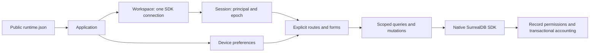

# Frontend architecture

The implementation is the separate [MetaSol application](../../MetaSol/README.md).
It uses ordinary Solid components, TanStack Router/Query and the native SurrealDB
SDK. This document describes code that exists, with further work in the
[deferred-work map](deferred-work.md).

## Tenant backend target (implementation deferred)

The backend contract and remaining native-engine limit are recorded in the
[2026-10-05 evidence](../rebase-system/evidence/2026-10-05-tenant-tree-verification.json).
MetaSol remains unchanged at `ada483e`; this section is its migration target.

A public connection profile identifies one fixed design namespace/database.
The selected tenant belongs to the authenticated session inside that design;
it is no longer represented by choosing a database. Include canonical tenant
identity in route/session/token/query scoping together with normalized endpoint,
design context, access method and epoch. Changing tenant clears old session
state and cached data even when the SDK connection can be reused.

Every signin path supplies tenant. Email/phone/passkey identities use owned_by;
remove visibility controls and old descendant-array assumptions. Native
permissions remain authoritative; explicit tenant/economic-entity filters can
reduce query candidates. Only declared published tree paths can use bounded
seek/page cursors. Keep native key and Decimal values, revision-aware cursors,
and epoch checks on all late queries/mutations/live notifications.

Record-scoped materialized views can contain several visible authorization
groups for one business key. Use their declared policy and native permissions
when reading or combining these groups. Carry the documented SurrealDB 3.3.0
ID-order scan workaround into affected source queries; do not hide duplicate
rows with client deduplication.

Sales tax entry uses components on each priced invoice line and exposes delivery,
invoice, tax-account, currency and rule provenance. One physical delivery may be
billed in several portions; each portion rounds separately at the issue timestamp.
Invoice-wide components remain separate inputs. Selecting both levels posts both
sets of taxes, so the form must make that choice explicit.
The current browser code has not been changed or reverified for these contracts.
The following sections retain its 2026-10-03 implementation description.

## Context ownership

| Context | Owns | Lifetime | Does not own |
| --- | --- | --- | --- |
| Application | Validated public runtime configuration, router, QueryClient, token-storage adapter | One browser application | Principal, business permissions, financial balances |
| Workspace | One SDK client, connection status, immutable connection identity | Profile/endpoint/access/namespace/database combination | Economic entity, another workspace's SDK client |
| Session | Record authentication, principal, storage choice, epoch, pending-auth fencing | One authenticated account in a workspace | Root credentials or permission enforcement |
| Preferences | Appearance, accent, density, display time zone, default session-storage choice | Device, with memory fallback | Filters, drafts, query results, tokens |
| Route | URL filters, page, sort, view; explicit query and form composition | Mounted route | Global selected record or global form state |
| Form | Plain input values, dirty state, stable source ID, last-read version | Open form | Offline write queue or independently editable derived totals |

The server's economic entity, record owner and principal are different concepts.
`organization:northstar` can be a financial entity; `rebase_user:operator` can own
its records; that user's inherited permissions decide which operations are
allowed. Changing an entity filter never changes authentication or ownership.
`session.can()` only controls affordances. The database checks every request.

## Workspace and session transitions

The URL is `/w/:profile/:namespace/:database/...`. `resolveWorkspace` includes
the normalized endpoint, engine and access method in the identity as well as
the visible route parameters. Reusing a profile name for a different endpoint
therefore does not reuse its tokens or cache.

`WorkspaceRoute` uses a keyed Solid owner. Changing the identity disposes the
old SDK client and subscriptions, cancels reads and removes its cached queries
and mutations. Child navigation keeps the same connection. Connect attempts
have a generation and timeout; late attempts cannot replace a newer client.

Session restoration waits for authentication before reading the principal.
Signing in, signing out, changing account and SDK expiry rotate the session
epoch. A query key begins with `['workspace', identity, epoch]`. A query or
mutation captures the client and epoch before starting and checks them again
after completion. An old response cannot populate the new account's screen.
This discards stale UI results; it does not cancel a committed server write.

Tokens default to memory in the parser. The checked-in runtime selects tab
storage explicitly. The user can choose memory, tab or device storage; moving
storage removes the previous copy after writing the destination. A storage
failure reports the actual fallback. Cosmetic preferences use their own key.
No query cache or financial drafts are persisted.

## State placement

- URL: committed search, economic entity, source kind, list page, sort, view,
  and production grouping. Browser Back/Forward restores those choices.
- Component: search text before submission, open dialogs, picker search/page,
  selected display currency on Overview, and unsaved form values.
- Query cache: server records and explicitly projected aggregates, scoped to
  the workspace and epoch. The default stale time is 30 seconds; refresh is
  explicit, with invalidation after successful writes and reconnects.
- Local storage: appearance and the explicitly selected token mode. Tokens
  themselves use the dedicated scoped adapter and chosen storage location.

No live accounting subscription is implied by the UI. There is no background
sync, optimistic financial balance or automatic mutation retry.

## Native data and mutation boundaries

[`values.js`](../../MetaSol/src/data/values.js) preserves native record table
and typed key. A serialized route/reference is parsed as `StringRecordId` and
bound as a value. URL strings never become SQL fragments. Dynamic table/order
names come from source-controlled finite allowlists.

Amounts remain decimal strings in controls and SDK `Decimal` at the database
boundary. Display formatting never converts money to `Number`. Dates enter in
device-local time and are saved as absolute instants. Editing preserves seconds
and milliseconds; an unchanged cash timestamp is omitted from the update.
`updated_at` remains the native last-read concurrency value.

[`writes.js`](../../MetaSol/src/data/writes.js) supplies three small transactional
operations, not a resource API. The caller authors the content object and
chooses an allowed native ID. Creates assert exactly one row. Updates and
deletes compare `updated_at`; deletion uses `RETURN BEFORE`. The SDK exposes
empty transaction result slots, so confirmation selects the one returned native
ID and checks every statement response, including the useful assertion after
an earlier transaction-cancellation response.

A create form generates its ID once. After a failure, submitting again uses
that same ID. After 20 seconds without confirmation the UI reports an unknown
outcome and allows an explicit inspection of that ID. The inspection shows only
reviewed nonsecret fields. A found record is evidence to compare, not an
automatic claim that the latest draft was saved. An absent row can also mean
missing access or a still-running request. Closing/reloading discards the draft;
copy the displayed reference before abandoning an uncertain request.

## Application composition and future clients

Business-specific builds compose explicit route modules and the existing small
UI pieces. Public runtime configuration supplies connections, not schemas,
routes, validation policy, menus or arbitrary plugins. There is one accounting
application now; a client portal or a CRM-only application should start with
its own few routes and share proven session/value/UI code only when needed.

Keep customer branding in semantic CSS tokens and authored components. Keep
customer business rules on server-owned records/contracts. Add another context
only when it has an independent lifetime and multiple actual consumers. Do not
make a provider per table, a client-side permission engine, a form registry, an
arbitrary query language or a new application framework.

The five public create-input JSON Schemas remain in
[`designs/all-in-accounting/schemas`](../all-in-accounting/schemas).
They describe a narrower JSON interchange shape than the native SDK supports,
especially for record keys. Current frontend adapters author explicit native
payloads and local validation; they do not generate forms from those schemas or
ship private schema/runtime bundles. Expanding shared public validation needs
the concrete contract work described in the deferred map.

## Files to change

| Concern | Files |
| --- | --- |
| Connection identity and public config | `MetaSol/src/app/runtime.js`, `public/runtime.json` |
| SDK lifecycle | `MetaSol/src/app/WorkspaceProvider.jsx` |
| Authentication and fencing | `MetaSol/src/app/SessionProvider.jsx`, `src/data/auth.js`, `src/app/queries.js` |
| Storage and preferences | `MetaSol/src/app/token-storage.js`, `PreferencesProvider.jsx`, settings route |
| One business workflow | Its route under `src/routes/` and its domain module under `src/data/` |
| Shared interaction | `MetaSol/src/ui/`, `src/styles/index.css` |
| Actual schema integration | `MetaSol/tests/accounting-server.js`, `accounting.test.js`, `accounting.spec.js` |

`routeTree.gen.js` is generated by Vite. The removed generic console, query
engine, resource registry and `/t/` routes stay removed.
