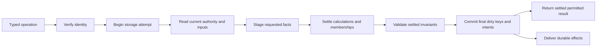

# A transaction workspace over conforming storage

**Status:** architecture proposal, 2026-10-21. The embedded feasibility example
checks staging and atomic persistence. Distributed guard behavior below is a
required adapter contract, not an implemented FoundationDB/TiKV adapter.

## 1. Separate execution, maintenance and commit

Current ReBase generates SurrealQL functions/events. Synchronous calculations,
tree repairs and validations occur inside the initiating database transaction;
internal UPDATE statements are not independent commits. Each user statement
settles and validates before the next, even inside `BEGIN ... COMMIT`.

The proposal loads/validates declarations once, then executes them as Rust plans.
One **attempt** owns the backend transaction, snapshot, cached nodes, old images,
staged records, dirty values, authorization context and changed-root/query work.
The containing operation either commits all its effects on stored state or fails.

A native compiled program is still a runtime. Model preparation eliminates
repeated declaration resolution; it does not replace execution or validation.
Transport parsing occurs once per request. Structural values are decoded when
first touched, operated on in Rust, and encoded once when finally dirty.

## 2. Workspace invariants

For every physical key, retain its original snapshot value and latest staged value.
Read-your-writes returns the staged version. Absence is a real value to protect.
Keep an original image even after deletion, so detaching several slots cannot
dereference a now-invisible source or restore obsolete links.

Repeated patches combine in this workspace. A key returned to its original value
need not produce a final business write. **Conflict obligations survive that
optimization:** an unchanged amount computed from a zero quantity still depends
on its rate source. Guard keys must change as required even when business values
end unchanged. Read sets and predicate protections cannot be discarded with
no-op patches.

Staged range queries must merge backend ranges with inserts, replacements and
tombstones. Cached lookups alone do not implement range read-your-writes. The
proof exercises point operations only; range-overlay support is a separate step.

The workspace's memory is proportional to touched state, rather than the whole
database. Shared paths can reduce repeated loads and writes, but independent
memberships still require their own maintenance. One logical commit can entail
many physical operations, WAL entries and compaction writes below the adapter.

## 3. Settlement and validation

1. Validate command shape and allowed fields; enforce permissions and explicit
   action preconditions against the current attempt's state.
2. Capture old facts/slots, detach obsolete contributions when needed, and stage
   the requested facts. A multi-command atomic operation can reference newly
   staged records subject to their declared lifecycle.
3. Resolve descriptors and evaluate pure fields in actual dependency order.
   Reconcile direct routes, ordered query slots, memberships and required outputs.
4. Discover affected consumers from old/new keys and consumed channels. Recompute
   until the finite causal work is settled; reject feedback and exhausted budgets.
5. Refresh validation-phase queries, publish changed roots, check affected global
   rules and prepare a result from the settled state.
6. Commit final dirty keys, protected guards, audit/operation receipts and effect
   intents together. Release the result only after confirmed success.

This is not a historical event replay. Historical inputs may require a large
reactive suffix, but summaries avoid replaying history merely to validate a bound.
No general arbitrary-function fixed-point solver is intended.

Early checks are useful when failure is conclusive: malformed references, invalid
inputs or an independent completed command. A global deficit during an incomplete
transfer can be repaired by its second leg; rejecting after the first internal
patch changes semantics. Final validation checks the entire relevant historical
summary, not merely the final account balance.

Default proposal: one explicit `mutate` call is the atomic final validation
boundary. Separately declared settled checkpoints retain independently valid
steps where a workflow requires them. This deliberately differs from the current
per-statement contract; do not silently promise equivalence.

## 4. The adapter is a semantic contract

The portable minimum is consistent point reads plus atomic multi-key commit and
defined protection for every fact/predicate used to calculate or authorize a write.
Ordered scans are useful optional infrastructure. Linked index traversal can use
point reads, so backend scan behavior need not shape every domain operation.

| Responsibility | Required behavior |
| --- | --- |
| Begin | One consistent snapshot/serialized transaction view |
| Read | Exact bytes or absence; visibility of staged writes |
| Protect | Register a tracked read/lock or an equivalent shared guard |
| Stage | Put/delete exact keys without exposing partial state |
| Commit | Atomic outcome; definitive conflict, success or uncertain outcome |
| Abort | Discard attempt; no stored partial result |
| Limits | Time, affected bytes, key/value size and retry budget visible to runtime |
| Optional range | Explicit order, half-open bounds, continuation and predicate protection |

The eventual asynchronous driver interface must fit remote reads without hiding
them behind blocking Rust calls. The proof's synchronous redb transaction is a
local mechanism check, not a chosen universal driver trait. Keep byte-key layout
versioned at the engine codec; adapters pass bytes and normalize transaction
semantics. Moving codecs per backend would multiply formats unnecessarily.

## 5. Why blind guard writes are insufficient

Under ordinary first-committer-wins snapshot isolation, two writers to one guard
can conflict. FoundationDB validates committed write-conflict ranges against the
attempt's **read** conflict ranges; concurrent blind writes alone need not conflict.
Use a non-snapshot/tracked guard read followed by a changed guard write, or the
adapter's documented equivalent. Never weaken all reads to snapshots and assume
an unrelated atomic batch restores the lost guarantee.

For every predicate `P` used by an operation, all edits that can invalidate `P`
must overlap its protection. Examples:

- Account balance: protect the touched root/version; every contributing edit
  changes that root's protected state.
- Uniqueness: protect an absent exact key or root guard; every insertion into
  that uniqueness scope participates.
- Rate/quantity: protect the read rate even when the current quantity is zero.
  Both rate edits and consumer registration/evaluation must honor the fence.
- Reverse dependency discovery: protect its range or source guard so a newly
  registered reader cannot be omitted during a concurrent source edit.
- Reference existence: protect the target and its reverse-reference scope;
  deletions cannot commit around a concurrent new link.
- Authorization: protect role, graph and session data used by the attempt;
  concurrent revocation must conflict when the operation requires fresh authority.

At first, a coarse tenant authorization guard can cover graph/role edits and
permission reads. Finer guards are a measured optimization, with the same coverage
proof. Shared summary roots serialize writers too; distribution does not remove
that logical bottleneck. Do not shard a global invariant away without defining
how it is still enforced atomically.

Under FoundationDB, a tracked authority read conflicts with an authority change
without forcing unrelated readers to write that guard. A snapshot-isolation
adapter using shared write guards may serialize those business operations too.
That portability cost must be visible; a lock/read-validation design can differ
by adapter while preserving the same semantic protection contract.

Conformance means each adapter passes these schedules, not merely that it offers
methods named `get` and `commit`. redb's normal writer transactions serialize
writers. FoundationDB's regular read conflict tracking is a natural distributed
target. TiKV TxnKV snapshot isolation needs suitable explicit protection. A raw
RocksDB WriteBatch, hash store, or SurrealDB query API is not automatically this
contract. PostgreSQL could supply a byte-record table and suitable isolation, but
that adapter also needs conformance; SurrealDB is a complete query system rather
than a public interchangeable raw KV interface.

## 6. Retry, unknown outcomes and limits

On a confirmed conflict, discard the snapshot, calculated patches and request
authority cache. Retry the whole operation with bounded attempts and backoff.
Never reuse stale read decisions. Mutating permissions inside an attempt invalidates
its cached scope as well; distinct database transactions need distinct caches even
when issued in one HTTP request or JSON-RPC batch.

Keep stable externally supplied operation/create identities across transport
retries. A durable operation receipt in the same commit can distinguish replay
from a new request; it must bind identity to input/model identity and enforce
access. A timeout can mean commit success with a lost response. Reconcile that
same operation before deciding whether to repeat it. Idempotency does not mean
returning a different operation's cached result.

FoundationDB's documented limits include approximately five seconds from the
first read and 10,000,000 bytes of affected data, with a recommendation to redesign
transactions over one megabyte. Keys are limited to 10,000 bytes and values to
100,000 bytes. Adapter versions and deployment settings must be checked when
implemented; see primary references in [sources.md](sources.md).

An atomic historical cascade that exceeds a supported backend's budget must reject
with a useful reason, or adopt an explicitly different asynchronous/versioned
publication design. Splitting it silently into partial commits violates the
current intent. This is a real distributed design gate, not solved by faster Rust.

## 7. External work

Pure local signing/read-only grants can run outside or before the transaction if
their inputs and authorization are verified appropriately. An irreversible email,
payment or provider mutation cannot be rolled back by aborting KV work and must
not run inside an automatically retried closure.

Commit a durable intent with business changes. A worker claims it with a lease,
records provider start, calls the provider and commits its allowlisted outcome.
Stable execution IDs support provider idempotency/reconciliation. Lost response
is uncertain; cancellation is intent, not evidence that an in-flight action stopped.
Inline response waiting and background work use the same lifecycle. A due time
supplies one-shot scheduling; recurring generation is a separate explicit policy.

The queue is a wakeup accelerator; durable intents are authoritative. Recovery
must discover committed undelivered work without relying on a one-time callback.
Retries, leases and reconciliation remain necessary even if transport/server
deployment is simplified. A library can supply plumbing, but external atomicity
and exactly-once delivery cannot be inferred from an `after` hook.
