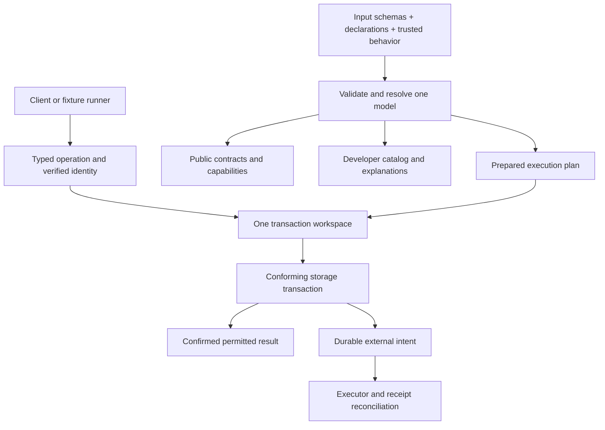

# Contract wireframes

**Research proposals, 2026-10-22. Nothing in this paper is an implemented API.**
These wireframes define observable behavior and responsibility before selecting
Rust interfaces or planning implementation. Names and JSON shapes may change;
a semantic change must update its scenario in [paper 8](08-research-workflow.md).
The current implementation and deliberate differences are mapped in
[paper 6](06-system-audit.md).

## 1. Five boundaries, one prepared model



| Boundary | Owns | Must not infer |
| --- | --- | --- |
| Authoring/model load | Field types, codes, units, roots, slots, direct/query dependencies, invariants and exposed operations | Runtime dependencies by executing arbitrary functions |
| Operation entry | Identity verification, shape decoding, server-selected design and operation | Authority from a client wrapper, index name or schema annotation |
| Engine | Current authority, staged facts, settlement, indexes, guards and result projection | Provider success or storage isolation from an adapter's name |
| Storage adapter | Snapshot/protection, atomic outcome and actual backend limits | Domain permissions, units or business validation |
| Tools/client/executor | Their explicitly allowed operations, UI state or external protocol | Direct access to raw KV as an ordinary mutation shortcut |

These are module responsibilities, not five services or a plugin system.
Trusted behavior receives declared typed inputs/query results rather than a
general database connection. Rust does not sandbox trusted code: code review
and the provided interfaces must preserve purity. Untrusted extensions remain
outside this design.

## 2. Model and artifact lifecycle

One design selects its authored JSON Schemas, declarations and trusted behavior.
Loading resolves names/codes and checks reference targets, root/member type
agreement, slot uniqueness, source unions, phase dependencies and callable
behavior. Invalid models fail before opening a writable application transaction.

Input validation and semantic binding are separate. JSON Schema `readOnly` and
`default` are annotations, not field permissions or commands to write values.
Reference existence, required participation, derived outputs and historical
invariants belong to the engine. Schema dialect, enabled formats and offline
reference resolution must be explicit and shared with client/tool validators.

Existing schemas need a transport review. For example, today's
`account_entry.account` pattern requires `treasury:...` or another allowed table
prefix; a bare UUID will fail it. Reauthor the selected model's reference
patterns/bindings for the new wire format, and retain allowed target contracts
in declarations. Faithful schema export is compatible with an intentional
breaking API change; “JSON Schema is portable” does not make old payloads so.

| Artifact | Audience and contents |
| --- | --- |
| Prepared plan | Engine only: resolved behavior and executable policy, with source/rule locations |
| Public contract | Authored public input schemas, exact scalar bindings, permitted operation/query shapes and published output fields; descriptive, never a permission grant |
| Developer catalog | Trusted authoring tool: every contract, private/generated role, possible reference, query, root, formula and source location; no deployment secrets or live records |
| Live inspection result | Authorized request: actual active slots, bounds, visible facts and bounded explanation; inaccessible values remain redacted |
| Fixture recipe | Design-owned defaults and deterministic authored inputs; never a stored collection of internal tree nodes |

The public catalog is not a copy of the developer catalog with a UI toggle.
An inspector may show the full offline catalog when supplied by its author;
connecting that inspector does not confer access to private records. The engine
must reject an unsupported catalog/model version rather than guessing fields.

Distinguish semantic model identity from presentation changes. The former binds
codebook, schemas/bindings, comparator/algebra semantics, declarations and behavior
revision. Hashing function names alone misses a changed function body. Appearance
and layout choices do not need to invalidate persisted calculation semantics.
The exact digest construction remains a model-load experiment, not a new runtime
registry. Build output should be deterministic for identical resolved inputs.

**Initial lifecycle proposal:** bind an empty disposable store to one model and
codec identity. Reopening with the identical identity is allowed. Refuse a
different identity in a populated store until an explicit rebuild/migration
contract exists. Schema codes cannot silently acquire a new meaning. This avoids
building legacy migration now while preventing accidental reinterpretation.
Each write attempt checks/protects the store's active model identity; an old
process cannot continue writing after a permitted model switch.

Build and explain do not activate a model, open a database or copy credentials.
Output preflight rejects source/output overlap and unsafe generated-file aliases
before any pruning. A disposable reset replaces the explicitly selected test
store; it is not a public bulk-delete endpoint. Backups/restores must retain the
model/codec identity and authoritative receipts, with workers stopped while
consistency is being restored. Production activation/restore is a later gate.

## 3. Exact values and record envelopes

The first scenario uses exact integral minor units and integral rates. It does
not choose production decimal precision. General money/rate/quantity support
requires an explicit range, scale, rounding mode and rounding point, including
negative ties and overflow under regrouping.

Proposed transport rules:

- UUIDs are canonical strings on the wire and 16-byte identities internally.
  Record results include their contract name/code separately; no caller infers
  type or tenant from UUID spelling. Root/member addresses add a declared slot.
- Potentially large integers, minor units, decimals and nanosecond timestamps
  use validated strings with declared bindings. Never route them through a JS
  `Number`. Timestamp range and timezone parsing are separate from UI formatting.
- Create supplies complete authored input; absent optional fields stay absent
  unless the contract declares a default. `0`, `false` and empty strings are
  distinct values. `null` is a value only where the field explicitly permits it.
- Update uses explicit `set` and `unset`. Omission means unchanged; `unset`
  removes an optional field. Setting and unsetting the same field rejects.
  Initially replace an entire nested object/array, rather than inventing deep
  patch semantics. Validate the resulting full record and required roles.
- Clients cannot set calculated values, tenant derivation, reader state, tree
  links, receipts or revisions. Owner changes have a specific authorization rule.
- A returned record has an opaque equality version. Updates/deletes require it.
  It changes with semantic record state, including relevant derived/authority
  state; a rotation alone is not a user edit. Store guards and tree/query
  revisions are separate obligations. `updated_at` remains display metadata.

## 4. Operations and mutation outcomes

| Proposed operation | Observable contract |
| --- | --- |
| `model.describe` | Obtain a supported public contract/capability projection; no credentials, privileged behavior or arbitrary schema introspection |
| `records.get` | One scoped identity/projection read; absent and inaccessible may share `not_found` |
| `records.page` | Distinct records from a registered complete reader access path, ordered and filtered within declared budgets |
| `records.exists` | `yes`, `no` or `unknown`; query exhaustion, not a page's emptiness, proves `no` |
| `roots.read` | Declared aggregate/selection/occurrence operation with root publication and source-return policies |
| `records.mutate` | One explicit atomic unit with final settled validation and stable operation identity |
| `operations.status` | Reconcile a mutation receipt under current caller/tenant permissions; never a provider queue inspection shortcut |

JSON-RPC only envelopes these operations. It supplies no model semantics,
transaction grouping or exactly-once processing. A JSON-RPC batch may execute
separate operations independently. Reject mutating JSON-RPC notifications in
the initial API because there is no response channel for their outcome.
The RPC `id`, source UUID and durable `operation_id` have different purposes.

Illustrative mutation shape; `<model identity>` is a placeholder:

```json
{
  "jsonrpc": "2.0",
  "id": "call-7",
  "method": "records.mutate",
  "params": {
    "model": "<model identity>",
    "operation_id": "00000000-0000-4000-8000-000000000007",
    "commands": [{
      "op": "update",
      "id": "00000000-0000-4000-8000-000000000001",
      "if_version": "v7",
      "set": {"units": "4"},
      "unset": []
    }],
    "returning": [{
      "id": "00000000-0000-4000-8000-000000000001",
      "fields": ["native_minor", "reporting_minor"]
    }]
  }
}
```

The server binds design, tenant and verified actor. A requested owner/reference
is checked; it is not the authentication context. Proposed initial command rules:

1. Allow one authored command per source UUID per mutation. Coalesce an editor's
   changes before submission. Internal derived/slot repairs may touch it repeatedly.
2. Commands may reference earlier staged creations. Forward references reject
   initially. They see earlier staged inputs, but do not consume a half-settled
   global aggregate as though it were final.
3. Keep principal/credential/model administration in separate named operations
   initially. A domain batch cannot grant itself rights and then use them.
4. Check action authority, old-version preconditions and input obligations;
   settle all consequences; then check historical/global invariants. Internal
   repair uses declared engine authority. Explicit independently valid checkpoints
   would be a separately declared operation, not a flag inferred from batching.
5. Construct the returned projection from settled state under its applicable
   permissions. Commit data, guards and receipt atomically; only then release
   success. Losing read access through the mutation can suppress returned fields.

This final-boundary proposal deliberately differs from current per-statement
settlement. It is still subject to the causal-settlement design gate in paper 8.

| Outcome | Client and engine behavior |
| --- | --- |
| Confirmed commit | Return operation identity, record versions and permitted settled projections; no optimistic financial recalculation in the client |
| Known validation/access/version rejection | No operation writes committed; preserve the draft and return a stable error kind, safe rule/field location and permitted details |
| Definite backend transaction conflict | A bounded whole-attempt retry may use the same normalized request/IDs; discard every cached read/permission decision first |
| Stale editor version | Do not “retry” by replacing its expected version with the new one; refresh/review is required |
| Transport/commit outcome unknown | Inspect/retry the same durable operation identity; do not manufacture another create ID or claim rollback |
| No receipt currently visible | “Not observed” can include an in-flight operation; absence alone is not definitive failure |

A receipt binds design, tenant, actor, model and normalized command content.
Same key/different content rejects. Concurrent same-key requests must not both
apply. Replays reauthorize result disclosure; a cached response cannot bypass a
later revocation. Retention/replay windows need a declared policy before an
external API promises deduplication forever. A rejected attempt need not create
a durable receipt merely to prove a local validation failure.

Expose stable error categories such as invalid input, unavailable reference,
stale version, invariant violation, query changed, work limit and uncertain
outcome. Provider/database error strings are diagnostic causes, not a public
regex protocol. Errors and explanations must not reveal private operands.

## 5. Queries: order, scope and budget

`records.page` starts from the current reader-principal scope. An owner index
alone cannot supply all readable records. General root pages count occurrences;
two member slots need not mean two distinct business records. Keep these APIs
semantically separate. Root aggregates use their declared publication boundary;
they are not recomputed over whichever leaves the client can see.

Root operations with ordinal/link semantics retain a clear policy: reject a
selected unreadable member rather than silently skipping it and changing rank
or page meaning. An explicitly authorized record-list access path instead
enumerates readable candidates. Projection, filtering and ordering all require
the relevant field permission. Unsupported ordering rejects before traversal.

**Bounds proposal:** distinguish a full occurrence key from a business-key
prefix. Use typed `before_prefix(p)` and `after_prefix(p)` boundaries to denote
positions before/after every extension of `p`. These names describe comparator
operations, not a textual query language. They avoid inventing a maximum UUID,
string sentinel or `timestamp + 1ns` at the maximum representable timestamp.
Ranges remain half-open. A reversed/equal query range is empty as today; a
stored interval membership still requires strictly ordered endpoints. The
comparator/binding experiment must cover all supported key types and ties.

K-way merge has two distinct phases:

1. Discover the complete authorized partition set and obtain each stream's
   first candidate or proof of emptiness (or a proven lower bound sufficient for
   an explicitly different plan). Until then, a result may not be globally first.
2. Merge comparable full-order streams and count all visited candidates, including
   residual-filter rejects. Hydrate/project within the same page snapshot.

Budget scope discovery, partition count, seeks, node loads, decoded bytes,
candidate visits, output bytes and elapsed time. A result limit only bounds
returned rows. Before initialization completes, return a setup/work-limit error
if the chosen plan cannot continue safely; do not claim an empty complete page,
`exists = no`, or invent a last-visited cursor. The first wireframe caps fanout;
resumable partial initialization and alternate tenant indexes are future choices.

After initialization, an empty filtered page can carry continuation. Cursor
position is the last visited full key, not the last returned match. `exists`
is `unknown` on incomplete search, `yes` on a readable match, and `no` only after
all permitted candidates are exhausted. A `yes` proves existence even if a full
ordered page has not been requested; it does not identify a global first match.

**Cursor proposal:** bind design/model, actor scope, query/order/projection,
position and relevant revisions in an opaque token; reauthorize each page.
Use an explicit restart on revision changes. Root topology revision alone is
insufficient: changing a residual-filter field can change page membership
without changing its index key. A query revision must cover all relevant row
changes, insertion into a previously empty partition, reader movement and policy
changes. The bounded experiment may use a revision vector for its few partitions.
A coarse tenant counter would simplify tokens but serialize more writers; that
is a tradeoff to measure, not a free optimization. No frozen multi-request
snapshot or bulk-export contract is implied.

## 6. Authority has a time boundary

Choose a clear initial contract: a read is authorized against the same fresh
snapshot as its data. A write validates its authority through the adapter's
commit protection. A revocation committed before a fresh read must be observed;
an overlapping read may serialize before the revocation and finish later.
Already delivered data cannot be recalled.

FoundationDB explicitly states that read-only transactions do not commit and
never conflict. Merely registering a read therefore does not guarantee
revocation at response-send time. Its normal reads also differ from its optional
non-conflicting “snapshot read” operation. See the
[developer guide](https://apple.github.io/foundationdb/developer-guide.html#how-foundationdb-detects-conflicts),
rechecked October 22. This is documentation-backed storage behavior, not an
executed adapter test. Stronger delivery-time/session cancellation would require
a separately defined protocol; it is not promised by per-attempt caching.

Preserve scalar reader selection order, direct-parent role semantics and
alternate DAG paths. Active source-owner/DAG changes repair readers and reader
indexes together. Adding a visibility-neutral membership cannot grant access.
Field permission applies to errors and traces as well as successful projection.

## 7. Developer and client flows

| Wireframe | Sequence and retained boundary |
| --- | --- |
| Add a dependent amount | Author input/type and named dependency once → model-load error points at the source if unresolved → explain shows actual order/root/channel → both catalogs derive their allowed projections → one source-based scenario checks it |
| Inspect a design | Open static developer catalog → choose graph/layout → select contract/slot/formula → optionally connect for bounded authorized active state; no automatic database connection or mutation |
| Prepare a demo | Select a new disposable store and model → provision explicit tenant/principals → preview seeded authored fixtures offline → apply through supported operations → read settled state → stop workers/connections and discard owned resources |
| Create a prerequisite in a form | Retain parent draft/create ID → save the child through the operation API → return its confirmed UUID → parent submission remains explicit |
| Save with a lost response | Retain draft/version/operation identity → show unconfirmed state → inspect same operation → accept confirmed result or keep uncertainty; session changes fence late callbacks |
| Change a model field | Resolve changed obligations → regenerate public/developer artifacts → reject stale artifact/model identities → run the affected scenario; no handwritten parser fix in the inspector or frontend |

Tools expose small ordinary functions. A Rust-only proof does not need a custom
REPL or a TypeScript runtime. Later a normal JS client/CLI may call the operation
API if interactive fixtures need it. Reuse presentation and seeded-generation
ideas where they fit; do not claim the current SurrealDB binder or SQL callbacks
are already portable.

## 8. External work and future capabilities

Business time, request time and task due time are different inputs. Deterministic
calculation uses declared data; random IDs/time/provider I/O must not leak into
an automatically retried formula. Freeze request-generated identities once;
time-sensitive authorization/expiry is checked at its declared attempt boundary.

Commit an effect intent with business state. A lease/attempt token fences worker
completion; provider-start and uncertain outcomes survive crashes. Recheck the
declared execution authority before loading credentials. An outbox wake is
replaceable; committed undelivered intents need bounded rediscovery. Verify and
deduplicate raw signed webhook input durably before acknowledging it. Reused
source IDs cannot make an old effect/receipt act on a new execution.

Private operation receipts, provider receipts and optional selected business
audit solve different problems. A bounded in-memory explanation is not a
permanent event history or a user notification inbox. Live UI subscriptions,
recurring schedules, large imports/exports, production migration and distributed
recovery retain separate gates. No server, worker, frontend port or generic
framework is created by these wireframes.
