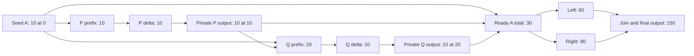
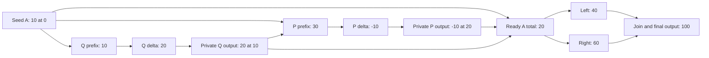

# M3/M5: moved prefix readers and required outputs

**Status: bounded contract and counterexamples, 2026-10-22.** This extends the
[scenario register](08-research-workflow.md#3-scenario-register), not the Rust
runtime. The contract below deliberately resolves addresses before ordered
arithmetic. General query-dependent addresses need a separate causal argument.

## 1. Question and current-source boundary

Can two prefix readers exchange positions while their private required outputs
carry the actual contributions, without reading obsolete values, accepting
feedback, or losing identities? What must be known before evaluating a query?

The current [query contract](../../designs/rebase-system/function-reactivity.md)
separates calculation from validation, keeps named slots, and removes former
positions before evaluating a move. Its
[adjustment fixture](../../dev-tools/temporal-tree/dependencies-fixture.surql)
uses `target - base - strictly_prior_changes`. The corresponding
[probe](../../dev-tools/temporal-tree/dependencies-probe.js) includes moves driven
by an upstream date. The
[required-output fixture](../../dev-tools/temporal-tree/required-outputs-fixture.surql)
and [probe](../../dev-tools/temporal-tree/required-outputs-probe.js) cover private
roles, stable identities, prerequisite order, activation and rejected deletion.
The [causal fixture](../../dev-tools/temporal-tree/causal-outputs-fixture.surql)
and [probe](../../dev-tools/temporal-tree/causal-outputs-probe.js) cover a diamond
and reject even a zero-valued output routed into its basis's input root.

These are inspected source contracts and historical test cases, not fresh
database executions. In particular, `prepare_move` in the current
[coordinator](../../dev-tools/compiler/temporal.surql) examines the moving
record's own business slots. This packet's reader has **no** such slot: its
managed child posts the amount. Separate existing cases do not establish this
combined behavior or the proposed final multi-command mutation boundary. This
is not a claim that a newly reproduced defect exists in the original runtime.

## 2. Permitted changes and graph meaning

For this bounded contract, resolve shape from final staged authored facts and
an acyclic direct-scalar dependency graph before reading ordered results.
“Shape” means active role/query slots, referenced roots, keys, bounds and phases.
Every mutable input to that preparation is declared and protected. A date copied
from an authored `Moment.at` is allowed; a date obtained from an unsettled prefix
is outside this contract. Calling both values “derived” would hide that difference.

| Change | Decision in this packet |
| --- | --- |
| Change a target amount | Allowed; values and downstream consequences may change without a rekey. |
| Move one or both readers, including a shared upstream authored-date edit | Allowed after resolving every affected final date; ignore command order when computing the final causal graph. |
| Reparent a reader to another existing same-unit account | Allowed; its query and posting use that same selected account here. Retire the old query and output positions. |
| Toggle a required posting role | Allowed by an authored flag. The reader and its queries remain active while that output is disabled. |
| Change a query bound | It follows the reader's resolved date in this fixture. Arbitrary independently editable bounds are not silently added to this schema. |
| Change a root, key, bound or activation using an ordered result | Deferred. An explicitly earlier settled stratum may eventually supply it, but this packet supplies no general dynamic-topology solver. |
| Route a downstream output back into an input | Reject when the final active calculation graph is cyclic, including declared zero-valued feedback. |
| Delete a reader or disable its output while a surviving REJECT reference targets that output | Reject the whole operation; internal engine authority does not bypass the reference policy. |

Use a vertex for a calculated field, named query result, output value or consumed
publication, rather than one vertex per record or root. Edges point **from input
to consumer**. A prefix query has incoming edges from final active occurrences
inside its bounds and from declared source metadata/fallbacks. A zero amount is
still an occurrence and a dependency. A whole-root read waits for all its relevant
contributors. A prefix read need not wait for later contributors in that root.

The logical graph includes each declared value input even when a coefficient
happens to be zero. Numeric equality can suppress later value work; it cannot
erase topology, source protection or a declared dependency. References that only
require existence are lifecycle obligations, not automatically scalar reads.
Ownership, reference, permission, AVL-link and calculation graphs remain distinct.

The **final** active calculation graph must be acyclic. Use both old and new
routes to discover invalidated work, but do not use their union as the graph for
cycle rejection or scheduling. A move can legitimately reverse a dependency.
Strictly prior timestamps prove order only when the producing occurrences have
the required relation to their producers' evaluation positions. Arbitrary
cross-root/backdated outputs can defeat that argument. Fixed slots alone prove
neither causality nor affordable fanout.

## 3. One exact combined fixture

All labels denote distinct fixed identities in one tenant. Amounts are exact
integer minor units of a single toy unit. Root keys use
`(time, source UUID, member slot)`; the strict upper bound is `before_prefix(time)`,
so **every** occurrence at the reader's timestamp is excluded. No `time + 1`
sentinel or UUID tie ordering changes that rule.

| Source or role | Declaration |
| --- | --- |
| Accounts A/B | History roots, duplicate timestamps allowed; seed contributions `10 @0` / `4 @0`. Complete-time balance must stay nonnegative, including the empty prefix. |
| Readers P/Q | Authored account, time, target and `post` flag. Two distinct queries, `q_before` in calculation and `q_guard` in validation, read the same strict prefix, fallback 0 on an existing empty range. `delta = target - q_before`. `q_guard >= 0` is a terminal check. |
| Required output `(P,post)` / `(Q,post)` | Present exactly when that source's `post` flag is true. Its one history slot contributes `delta` at the source's resolved time/account. The parent does not also contribute. |
| Left basis L | Tree-less source: `value = 2 * sum(A.history)` via a named whole-root query. Its required output contributes that value into `left.history` at the fixed authored time 40. |
| Right basis R | Tree-less source: `value = 3 * sum(A.history)`. Its required output contributes into `right.history` at time 40. |
| Join J | Two named whole-root queries consume left/right histories; `value = left + right`. Its required output contributes into `final.history` at time 40. |
| Reference U, when present | Trusted fixture source with `ON DELETE REJECT` reference to `(P,post)`. This is not a public way to read or forge a private output. |

L/R/J and their outputs remain present when P or Q is removed. Reports do not
contribute back into A/B. Their time 40 is authored, not derived from a query.
The reporting diamond counts each declared branch once; these toy branch weights
do not claim an accounting consolidation or imply conservation across roots.

At most two prefix readers, targets with absolute value at most 100, and fixed
branch factors 2/3 bound every value and partial sum far below `i128` limits.
With two readers, any prefix magnitude is at most 210, any reader delta at most
310, and A's final magnitude at most 210; branch magnitudes are at most 420/630
and the join at most 1050. The checker uses exact integers. General decimal
policy and arbitrary-depth amplification remain outside this bound.

### Baseline and swapped graph

Baseline: P targets 20 at time 10; Q targets 30 at time 20; both post into A.

After one atomic mutation sets P to 20 and Q to 10:

For compact evaluation-order checks, each source and its query-free output can
be treated as one step. Then the changing edges are `P → Q` before and `Q → P`
after. Both P/Q contributions feed L/R, and L/R feed J. Output expansion above
explains why that contraction is valid here; it would not justify contracting
arbitrary children with their own calculations. Validation queries are terminal
consumers of settled state and cannot feed calculations.

### Complete expected changes

Rows independently start from the baseline unless stated otherwise. A/B balances
include seeds. Left/right/final each contain one output and no seed.

| Case | P before / delta | Q before / delta | A / B totals | Left / right / final |
| --- | --- | --- | --- | --- |
| Baseline | 10 / 10 | 20 / 10 | 30 / 4 | 60 / 90 / 150 |
| Swap P/Q times | 30 / -10 | 10 / 20 | 20 / 4 | 40 / 60 / 100 |
| Move only P to 30 | 30 / -10 | 10 / 20 | 20 / 4 | 40 / 60 / 100 |
| Reparent P to B | 4 / 16 | 10 / 20 | 30 / 20 | 60 / 90 / 150 |
| Disable P's posting | 10 / 10 (no output) | 10 / 20 | 30 / 4 | 60 / 90 / 150 |
| Reenable P after that disable | 10 / 10 | 20 / 10 | 30 / 4 | 60 / 90 / 150 |
| Delete P | absent | 10 / 20 | 30 / 4 | 60 / 90 / 150 |
| P and Q both at 20 | 10 / 10 | 10 / 20 | 40 / 4 | 80 / 120 / 200 |
| Set P target to 10 | 10 / 0 (output retained) | 10 / 20 | 30 / 4 | 60 / 90 / 150 |

The same-time row is deliberately not serial target-setting: both read the
strictly earlier balance 10. The declared formulas therefore leave 40 after the
complete timestamp. Enforcing a different end-level rule would need an explicit
invariant or uniqueness restriction, not an accidental physical tie order.

The baseline has five managed outputs, seven financial occurrences including
the two seeds, and eight query identities: two each on P/Q, one each on L/R,
and two on J. Disabling P leaves four outputs, six financial occurrences and
all eight queries. Deleting P leaves four outputs, six occurrences and six
queries. A zero P output retains the full baseline inventory. Totals alone
cannot distinguish these states.

## 4. Counterexamples that constrain settlement

1. **Union of graphs:** the union contains `P → Q → P` for the valid swap.
   Its cycle is evidence of a changed order, not active feedback in final state.
2. **Old order after detaching both outputs:** evaluating P before Q in the
   swapped state gives P delta 10, then Q delta 20, total 40 instead of 20.
   Missing pending contributions cannot be treated as settled zeroes. A queue
   that revisits invalidated readers could repair this, but “detach, evaluate
   each dirty record once” is not a sufficient contract.
3. **Only the requested source is dirty:** moving P to 30 and removing its old
   output still leaves Q's obsolete delta 10. Evaluating P now gives delta 0;
   refreshing Q later gives 20, leaving total 30 instead of 20 unless P is
   revisited. The invalidated closure includes unchanged-position readers and
   the outputs managed by those readers.
4. **Zero-valued feedback:** let J additionally emit `0 * J.value` into A at 5,
   with J.value an explicitly declared input. A feeds L/R, those feed J, and J
   feeds A. Reject even though numerical totals could stabilize unchanged.
   No fixed-point iteration or value-based cycle exemption is intended.
5. **Wrong validation time:** set P target to -1. Its delta becomes -11, Q's
   becomes 31, and the final A total and report totals equal the baseline.
   A's history is `10 @0, -11 @10, 31 @20`; its complete-time minimum is -1.
   Reject everything, including the source edit and output/query repairs.
6. **Disappearing required child:** with U referencing P's private output,
   deleting P or disabling its posting would leave a dangling reference. Reject
   and retain the original state. Remove U in the explicit operation first if
   the declared command/reference policy permits that operation. A reference
   removed by the same authorized operation is not a surviving blocker.

These are obligations for a future runtime, not assertions that a specific
queue, storage rollback or permission implementation was exercised here.

## 5. Identity, coalescing and lifecycle

Required output ownership is the unique logical pair `(source UUID, role code)`.
Updates, moves and disable/reenable preserve that role's output identity during
the source's lifetime. It is a separate protected record, unlike a membership
slot, which is only part of its source's projection.

The old table-prefixed compound ID is not the new UUID wire format. Proposed
minimal binding: reserve a collision-checked output UUID in the source's private
fixed role slot, transactionally with first activation, and retain the reservation
while inactive. Reenable uses that UUID. Reserve prerequisite identities before
constructing their dependents; create prerequisites first and remove dependents
first. A hash of `(source, role)` alone is not a proof of unique allocation.
The model below checks logical pairs only, not the allocator or persisted map.
Deletion ends this fixture's source lifetime; a new source uses a fresh UUID.
Reuse of deleted source UUIDs and durable incarnation policy remain D2/W/F work.

Clients cannot create, edit, delete, or enumerate these private outputs directly.
The engine reconciles them through the source's declared recipe, without
bypassing tenant, existence, reference or invariant checks. An explanation can
show the role in the developer catalog; that is not public access to its state.

A separate one-source M5 control avoids hiding identities behind prefix arithmetic:

| Declared role in this order | Destination/value | Expected maintained identity |
| --- | --- | --- |
| `z_financial` | K at 5, +7 | First declared representative of the net +5 at 5 |
| `a_financial` | K at 5, -2 | Coalesces only into that declared financial group |
| `later` | K at 8, +3 | Separate occurrence at 8; K total 8 and occurrence count 2 |
| `q_first`, `q_second` | Both consume K in `[0,10)` | Two distinct query identities, each result 8 |
| `i_first`, `i_second` | Both have interval `[4,9)` | Two distinct interval identities, never financially coalesced |

Provider array order and lexical order do not select the representative. Changing
one interval's upper endpoint to 10 changes its maintained descriptor even with
the same lower endpoint and numeric channel. Deleting the source removes both
financial occurrences, both query slots and both interval slots. Explicit
coalescing policy does not merge distinct managed output records sharing a root.

## 6. Settlement obligations and bounded evidence

The resolved finite shape and pure formulas define one value state by induction
over the final DAG. Any valid topological order gives that same state. This is
the mathematical reason for confluence here, not a proposed production scheduler.

An eventual incremental engine must retain old images, discover affected work
through old/new routes, and retire obsolete or unavailable contributions of that
closure, including managed children. Unresolved final contributors remain pending;
their absence from a temporary tree does not mean the query's result is ready.
Only queries whose relevant final contributors are settled can produce final
values. Conservatively rebuilding this tiny fixture is an oracle strategy, not
permission to scan or rebuild a populated store after every write.

Stage required outputs and internal root publications as their inputs become
ready. A join may not read one new branch and one old branch. After calculations
and output lifecycles settle, refresh validation queries and check invariants.
Publish the permitted response only after the atomic commit. Internal publication,
terminal validation and external disclosure are three different boundaries.

The bounded [executable model](https://github.com/DivyeshVora79909/ReBase/blob/0d0601187c79d430f8d7ed41674f53e9905af75f/rebase-next/research/experiments/m3_m5.py) compares exact grouped source
scans, hand-worked expectations and every valid order of five fixed calculation
steps. It retains the invalid-order and old/new-union counterexamples, checks
complete logical inventories, and predicts feedback, historical-floor and
referenced-output rejection. Its [evidence](evidence/2026-10-22-m3-m5.json) records
execution and input hashes separately from the then-unchanged Rust proof.

This does not implement an AVL, reverse interval discovery, storage, UUID
allocation, authority, RPC, retries or production scheduling. The subsequent
[M6 packet](10-independent-checker.md) now defines the source-derived checker
contract and exercises synthetic links/roots/summaries; that is separate evidence
from this M3/M5 arithmetic experiment. General
ordered-result-dependent shape, latest/next selection interactions and real
incremental/concurrent M3/M5 settlement are deferred. The subsequent
[first native slice](12-native-slice.md) accepts the simpler M1/M2/M4 fixture
through real redb observations. It implements neither this prefix/output
schedule nor its private lifecycle. Continue from paper 8's named gate instead
of repeating the completed native source-oracle stage.
